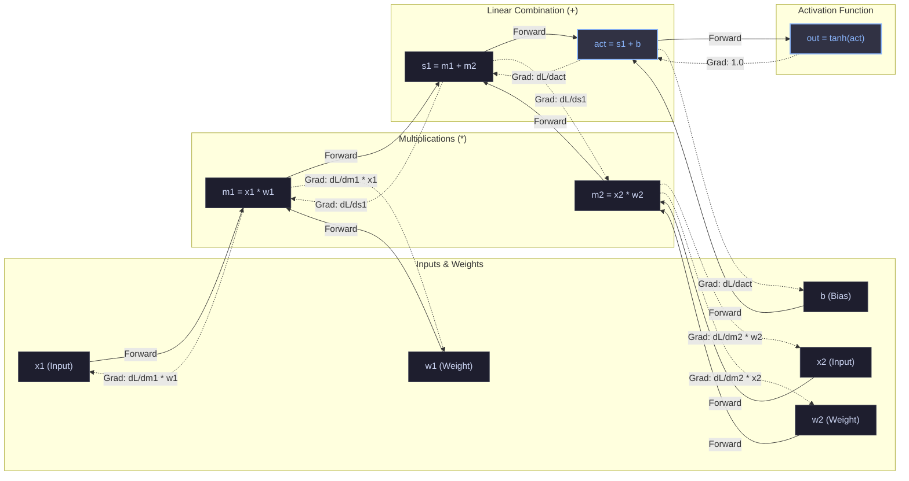
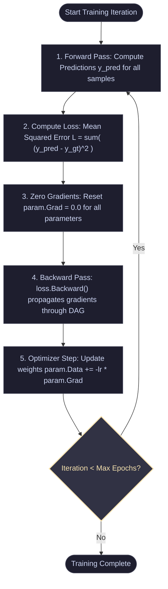

# MicrogradCs

[](https://dotnet.microsoft.com/)
[](https://learn.microsoft.com/dotnet/csharp/)
[](LICENSE.txt)
[](#zero-external-dependencies)

A tiny, pure C# port of Andrej Karpathy's [micrograd](https://github.com/karpathy/micrograd). **MicrogradCs** is an educational, scalar-valued automatic differentiation (autograd) engine and neural network library built in modern C# with **zero external dependencies**.

It implements reverse-mode automatic differentiation (backpropagation) over dynamically generated Directed Acyclic Graphs (DAGs) alongside a modular Multi-Layer Perceptron (MLP) framework.

---

## Table of Contents

- [Overview](#overview)
- [Key Features](#key-features)
- [How It Works](#how-it-works)
  - [1. Scalar Autograd Engine (`Value`)](#1-scalar-autograd-engine-value)
  - [2. The Computation Graph & Topological Sort](#2-the-computation-graph--topological-sort)
  - [3. Neural Network Abstractions (`Neuron`, `Layer`, `MLP`)](#3-neural-network-abstractions-neuron-layer-mlp)
- [Architecture & Workflow Diagrams](#architecture--workflow-diagrams)
  - [Computation Graph & Backpropagation Flow](#computation-graph--backpropagation-flow)
  - [MLP Network Architecture](#mlp-network-architecture)
  - [Training Loop Workflow](#training-loop-workflow)
- [Mathematical Foundations](#mathematical-foundations)
- [Project Structure](#project-structure)
- [Getting Started](#getting-started)
  - [Prerequisites](#prerequisites)
  - [Build and Run](#build-and-run)
  - [Sample Output](#sample-output)
- [Usage Examples](#usage-examples)
  - [Basic Autograd](#basic-autograd)
  - [Training an MLP Classifier/Regressor](#training-an-mlp-classifierregressor)
- [C# Implementation Highlights](#c-implementation-highlights)
- [License](#license)
- [Acknowledgements](#acknowledgements)

---

## Overview

Modern deep learning frameworks like PyTorch, JAX, and TensorFlow can feel like black boxes with millions of lines of C++ and CUDA code. **MicrogradCs** strips away all tensors, CUDA kernels, and memory pools to expose the pure mathematical core of deep learning:

- Every scalar number is represented by a `Value` object.
- Operations on `Value` objects (`+`, `-`, `*`, `/`, `Exp`, `Pow`, `Tanh`) construct a computational DAG dynamically in memory.
- Calling `.Backward()` on any scalar node triggers a reverse topological sort, evaluating partial derivatives via the **chain rule** and accumulating gradients across all ancestor nodes.
- A tiny Multi-Layer Perceptron (MLP) built on top of `Value` can learn non-linear decision boundaries through Stochastic Gradient Descent (SGD).

---

## Key Features

- **Zero External Dependencies**: Standard library only (`System`, `System.Collections.Generic`, `System.Linq`).
- **Idiomatic C#**: Full operator overloading (`+`, `-`, `*`, `/`, unary `-`), implicit conversions from `double`, and clean functional patterns.
- **Dynamic DAG Autograd**: Graphs are created on-the-fly during the forward pass; no static compilation or shape checking required.
- **Multivariate Chain Rule Gradient Accumulation**: Correctly accumulates gradients (`Grad += ...`) when variables branch into multiple paths.
- **Full Neural Network Stack**: Implements `Neuron`, `Layer`, and `MLP` with configurable layer widths and activations.

---

## How It Works

### 1. Scalar Autograd Engine (`Value`)

Each `Value` instance encapsulates:
- `Data`: The forward-pass scalar value (`double`).
- `Grad`: The accumulated gradient ($\frac{\partial \text{Loss}}{\partial \text{Data}}$), initially `0.0`.
- `Prev`: Pointers to predecessor nodes that produced this value.
- `Op`: The operation symbol (e.g. `+`, `*`, `tanh`) for visualization and debugging.
- `BackwardAction`: An internal `Action` delegate (closure) holding the analytical local derivative for that specific operation.

### 2. The Computation Graph & Topological Sort

When math operations are chained together:
```csharp
var a = new Value(2.0);
var b = new Value(-3.0);
var c = new Value(10.0);
var d = a * b + c;
d.Backward();
```

1. **Forward Pass**: `a * b` creates an intermediate node `n1` (`data = -6.0`), which then adds `c` to produce `d` (`data = 4.0`).
2. **Reverse Pass**: `d.Backward()` performs a Depth-First Search (DFS) post-order traversal to build an ordered list of nodes such that every node appears after its dependencies.
3. **Execution**: Gradients are propagated backwards from `d` down to leaves `a`, `b`, and `c` by invoking each node's local `BackwardAction`.

### 3. Neural Network Abstractions (`Neuron`, `Layer`, `MLP`)

- **`Neuron`**: Computes an affine transformation followed by a hyperbolic tangent activation:
  $$y = \tanh\left(\sum_{i=1}^{n} w_i x_i + b\right)$$
- **`Layer`**: A parallel collection of `Neuron` instances accepting an input vector of dimension $n_{\text{in}}$ and emitting an output vector of dimension $n_{\text{out}}$.
- **`MLP`**: A sequential pipeline of `Layer` instances chaining activations end-to-end.

---

## Architecture & Workflow Diagrams

### Computation Graph & Backpropagation Flow

The diagram below shows how a single neuron computation dynamically forms a Directed Acyclic Graph (DAG) during the forward pass, and how gradients propagate in reverse:



---

### MLP Network Architecture

The default demo model defines an MLP with architecture `[3, 4, 4, 1]` (3 inputs, two hidden layers of 4 neurons each, and 1 output neuron):

```mermaid
flowchart LR
    subgraph InputLayer ["Input Features (3)"]
        direction TB
        in0["x0"]
        in1["x1"]
        in2["x2"]
    end

    subgraph Hidden1 ["Hidden Layer 1 (4 Neurons + Tanh)"]
        direction TB
        h1_0["N 1.1"]
        h1_1["N 1.2"]
        h1_2["N 1.3"]
        h1_3["N 1.4"]
    end

    subgraph Hidden2 ["Hidden Layer 2 (4 Neurons + Tanh)"]
        direction TB
        h2_0["N 2.1"]
        h2_1["N 2.2"]
        h2_2["N 2.3"]
        h2_3["N 2.4"]
    end

    subgraph OutputLayer ["Output Layer (1 Neuron + Tanh)"]
        out0["N 3.1 (y_pred)"]
    end

    InputLayer --> Hidden1
    Hidden1 --> Hidden2
    Hidden2 --> OutputLayer

    classDef default fill:#1E1E2E,stroke:#45475A,stroke-width:1px,color:#CDD6F4;
    classDef nodeStyle fill:#313244,stroke:#A6E3A1,stroke-width:1px,color:#A6E3A1;
    class h1_0,h1_1,h1_2,h1_3,h2_0,h2_1,h2_2,h2_3,out0 nodeStyle;
```



---

### Training Loop Workflow

The training loop follows standard deep learning optimization mechanics:



---

## Mathematical Foundations

When a function $L = f(u)$ depends on $u = g(x)$, the derivative of $L$ with respect to $x$ is given by the chain rule:

$$\frac{\partial L}{\partial x} = \frac{\partial L}{\partial u} \cdot \frac{\partial u}{\partial x}$$

When a variable $x$ branches to multiple paths $u_1, u_2, \dots, u_k$, the multivariate chain rule sums the gradient contributions:

$$\frac{\partial L}{\partial x} = \sum_{j=1}^{k} \frac{\partial L}{\partial u_j} \cdot \frac{\partial u_j}{\partial x}$$

### Supported Primitive Operations

| Operation | Forward Formulation | Analytical Backward Formula |
| :--- | :--- | :--- |
| **Addition** | $z = x + y$ | $\frac{\partial L}{\partial x} += 1 \cdot \frac{\partial L}{\partial z}, \quad \frac{\partial L}{\partial y} += 1 \cdot \frac{\partial L}{\partial z}$ |
| **Multiplication** | $z = x \cdot y$ | $\frac{\partial L}{\partial x} += y \cdot \frac{\partial L}{\partial z}, \quad \frac{\partial L}{\partial y} += x \cdot \frac{\partial L}{\partial z}$ |
| **Unary Negation** | $z = -x$ | $\frac{\partial L}{\partial x} += -1 \cdot \frac{\partial L}{\partial z}$ |
| **Subtraction** | $z = x - y = x + (-y)$ | Derived via Addition and Negation |
| **Exponentiation** | $z = e^x$ | $\frac{\partial L}{\partial x} += e^x \cdot \frac{\partial L}{\partial z} = z \cdot \frac{\partial L}{\partial z}$ |
| **Power** | $z = x^c$ ($c \in \mathbb{R}$) | $\frac{\partial L}{\partial x} += c \cdot x^{c-1} \cdot \frac{\partial L}{\partial z}$ |
| **Division** | $z = \frac{x}{y} = x \cdot y^{-1}$ | Derived via Multiplication and Power |
| **Tanh** | $z = \tanh(x) = \frac{e^{2x} - 1}{e^{2x} + 1}$ | $\frac{\partial L}{\partial x} += (1 - z^2) \cdot \frac{\partial L}{\partial z}$ |

---

## Project Structure

```text
MicrogradCs/
├── .github/              # GitHub repository metadata & workflows
├── Engine.cs             # Autograd engine (Value) & NN primitives (Neuron, Layer, MLP)
├── Program.cs            # Entry point running the binary classification demo
├── MicrogradCs.csproj    # .NET project configuration (.NET 10.0 / C# 13)
├── MicrogradCs.sln       # Visual Studio / Rider solution file
├── LICENSE.txt           # Apache 2.0 Open Source License
└── README.md             # Project documentation
```

---

## Getting Started

### Prerequisites

- [.NET SDK 8.0, 9.0, or 10.0+](https://dotnet.microsoft.com/download)

Verify your .NET installation:
```bash
dotnet --version
```

### Build and Run

1. **Clone the repository:**
   ```bash
   git clone https://github.com/your-username/MicrogradCs.git
   cd MicrogradCs
   ```

2. **Restore and Build:**
   ```bash
   dotnet build
   ```

3. **Run the training loop:**
   ```bash
   dotnet run
   ```

### Sample Output

Running the demo executes 50 training iterations on a 4-sample dataset. Notice the loss continuously decreasing:

```text
Iteration  1  Loss: 6.22313330052573
Iteration  2  Loss: 4.184353592020129
Iteration  3  Loss: 1.9913082768444035
Iteration  4  Loss: 0.8400338523201376
Iteration  5  Loss: 0.4248335391191669
Iteration 10  Loss: 0.10037312873956127
Iteration 20  Loss: 0.035514895640949506
Iteration 30  Loss: 0.020813796228508194
Iteration 40  Loss: 0.014520357852392043
Iteration 50  Loss: 0.01107137535030183
```

---

## Usage Examples

### Basic Autograd

Compute derivatives of arbitrary mathematical expressions:

```csharp
using KarpathyAI;

// 1. Declare scalar values
var a = new Value(-4.0);
var b = new Value(2.0);

// 2. Build forward expression: c = ((a + b) * b)^2 + e^a
var c = a + b;
var d = a * b + b.Pow(3);
c += c + 1;
c += 1 + c + (-a);
var d2 = d + d * 2 + (b + a).Tanh();
var d3 = d2 + 3 * d + (b - a).Tanh();
var e = c - d3;
var f = e.Pow(2);
var g = f / 2.0;
g += 10.0 / f;

// 3. Backpropagate
g.Backward();

// 4. Read gradients
Console.WriteLine($"g data: {g.Data}"); // Forward result
Console.WriteLine($"a grad: {a.Grad}"); // dg/da
Console.WriteLine($"b grad: {b.Grad}"); // dg/db
```

### Training an MLP Classifier/Regressor

```csharp
using KarpathyAI;

// Create an MLP with 3 inputs and layer sizes [4, 4, 1]
var model = new MLP(nin: 3, nouts: new[] { 4, 4, 1 });

// Training dataset (4 samples, 3 features each)
double[][] xs =
[
    [2.0,  3.0, -1.0],
    [3.0, -1.0,  0.5],
    [0.5,  1.0,  1.0],
    [1.0,  1.0, -1.0]
];

// Target labels
double[] ys = [1.0, -1.0, -1.0, 1.0];

// Optimization loop
double learningRate = 0.05;

for (int epoch = 0; epoch < 100; epoch++)
{
    // Forward pass
    var predictions = xs.Select(x => model.ForwardScalar(x)).ToList();

    // Squared error loss: sum((y_pred - y_gt)^2)
    Value loss = 0.0;
    for (int i = 0; i < ys.Length; i++)
    {
        var diff = predictions[i] - ys[i];
        loss += diff.Pow(2);
    }

    // Zero gradients
    foreach (var p in model.Parameters())
    {
        p.Grad = 0.0;
    }

    // Backward pass
    loss.Backward();

    // Stochastic gradient descent step
    foreach (var p in model.Parameters())
    {
        p.Data += -learningRate * p.Grad;
    }

    if ((epoch + 1) % 10 == 0)
    {
        Console.WriteLine($"Epoch {epoch + 1,3} | Loss: {loss.Data:F6}");
    }
}
```

---

## C# Implementation Highlights

| Feature | C# Solution | Why It Matters |
| :--- | :--- | :--- |
| **Syntactic Ergonomics** | `operator +`, `operator *`, etc. | Allows writing natural mathematical formulas like `w * x + b` instead of verbose method calls like `w.Multiply(x).Add(b)`. |
| **Seamless Interop** | `implicit operator Value(double)` | Allows mixing C# primitive `double` literals directly in algebraic expressions (`loss += diff.Pow(2)`). |
| **Local Closures** | `Action BackwardAction` | Encapsulates local derivatives directly inside the parent node's closure during construction. |
| **Topological Traversal** | Recursive DFS with `HashSet<Value>` | Guarantees exact reverse topological ordering without external graph packages. |
| **Memory Efficiency** | Explicit `HashSet<Value>` children | Minimal memory footprint per node, allowing thousands of graph nodes with zero overhead. |

---

## License

This project is licensed under the **Apache License 2.0**. See the [LICENSE.txt](LICENSE.txt) file for details.

---

## Acknowledgements

- **Andrej Karpathy** for the original [micrograd](https://github.com/karpathy/micrograd) Python repository and his masterclass lecture: *["The spelled-out intro to neural networks and backpropagation: building micrograd"](https://www.youtube.com/watch?v=VMj-3S1tku0)*.
- The open-source .NET and machine learning communities for making high-performance AI accessible.